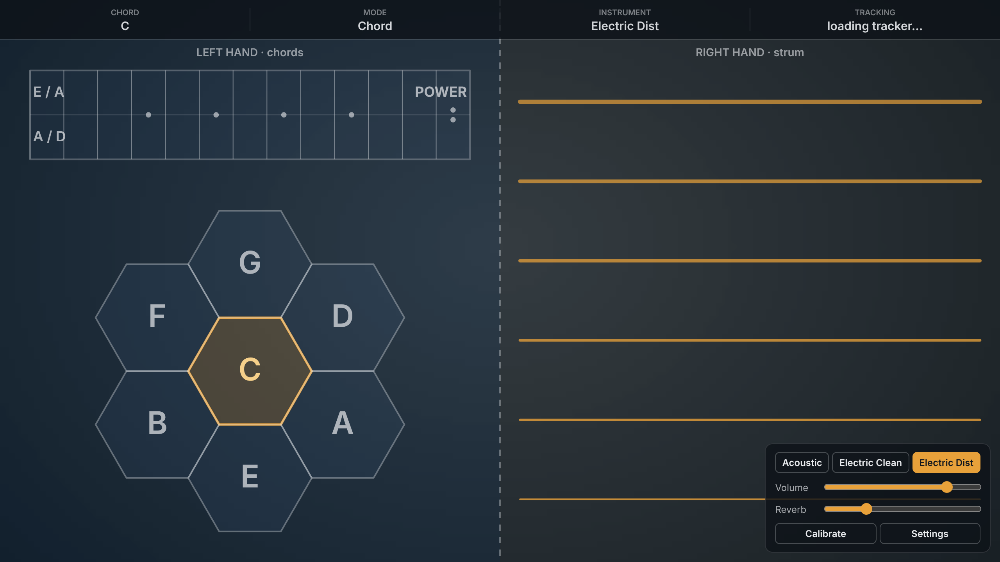
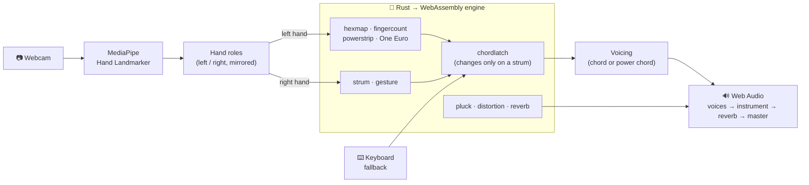

<div align="center">

# 🎸 strhapshody

**Air guitar in your browser.**
Your webcam watches both hands — the left picks the chord, the right strums six virtual strings.

<br/>

[](https://www.typescriptlang.org/)
[](https://www.rust-lang.org/)
[](https://rustwasm.github.io/wasm-bindgen/)
[](https://vite.dev/)
<br/>
[](https://ai.google.dev/edge/mediapipe/solutions/vision/hand_landmarker)
[](https://developer.mozilla.org/docs/Web/API/Web_Audio_API)
[](https://vitest.dev/)
[](https://playwright.dev/)

[](engine/)
[](src/)
[](e2e/)
[](#-tests)
[](TASKS.md)
[](#-tech-stack)
[](#-setup)

[How to play](#-how-to-play) · [Setup](#-setup) · [Tech stack](#-tech-stack) · [Architecture](#-architecture) · [Tests](#-tests) · [Manual checklist](#-manual-test-checklist)

<br/>



<sub>Keyboard demo mode right after strumming <b>C</b> on <b>Electric Dist</b> — chord flower and power strip on the left, strings glowing on the right.</sub>

</div>

---

## ✨ Features

- 🖐️ **Two-hand control** — hover a hex for the chord root, lift 1 / 2 / 3 fingers for major / minor / 7th.
- 🎯 **Circle-of-fifths hex flower** with border hysteresis, so chords never flicker on a seam.
- ⚡ **Power chords** — a fretboard strip: left–right picks the fret (0–12), height picks the string pair. Shows e.g. `G5 (fret 3, low E)`.
- 🎵 **Real strumming** — downstrokes, upstrokes, speed → loudness and brightness, the natural rake of a real strum.
- ✊ **Palm mute & fist stop** — open flat palm for short muted notes, a fist to silence everything.
- 🎸 **Three instruments** — Karplus-Strong acoustic, electric clean, and electric distortion, plus reverb.
- 🧭 **20-second calibration** fits the play zones to your reach; ↔️ **left-handed mode** mirrors everything.
- ⚠️ **Tracking warnings** when it's too dark or a hand drifts out of frame.
- ⌨️ **Keyboard mode** — play the whole thing without a camera.
- 🔒 **Fully on-device** — no video ever leaves your laptop.

---

## 🎮 How to play

```
┌──────────────── status bar: CHORD · MODE · INSTRUMENT · TRACKING ────────────────┐
│  LEFT HAND · chords                     │  RIGHT HAND · strum                     │
│  ┌──────── power-chord strip ────────┐  │  ───────────── low E                    │
│  │ E/A  frets 0 … 12 →               │  │  ───────────── A                        │
│  │ A/D                               │  │  ───────────── D                        │
│  └───────────────────────────────────┘  │  ───────────── G                        │
│                  G                      │  ───────────── B                        │
│              F       D                  │  ───────────── high e                   │
│                  C                      │                                         │
│              B       A                  │                                         │
│                  E                      │                                         │
└─────────────────────────────────────────┴─────────────────────────────────────────┘
```

The picture is mirrored like a mirror, so your left hand appears on the left.

<table>
<tr>
<td valign="top" width="50%">

**🫲 Left hand — chords**

| Do this | Result |
| --- | --- |
| Hover your palm over a hex | Chord root (C in the middle, G at the top) |
| ☝️ Index up | Major |
| ✌️ Index + middle | Minor |
| 🤟 Index + middle + ring | Dominant 7th |
| Move up into the strip | **Power mode** — x = fret, upper half = root on low E, lower = root on A |
| Drop back to the hexes | **Chord mode** |

</td>
<td valign="top" width="50%">

**🫱 Right hand — strum**

| Do this | Result |
| --- | --- |
| ⬇️ Sweep down | Downstroke (top → bottom) |
| ⬆️ Sweep up | Upstroke |
| 💨 Faster | Louder and brighter |
| 🖐️ Open flat palm | Palm mute |
| ✊ Closed fist | Stop — silences every string |

</td>
</tr>
</table>

> [!TIP]
> The chord you hover only **sounds on your next strum** — moving the left hand never changes a
> ringing chord, exactly like a real guitar.

**🧭 First run:** a short **How to play** guide opens first (reopen it any time with <kbd>H</kbd> or the
*How to play* button). When you close it, a 20-second calibration starts once both hands are visible:
hold your left hand up and move it around, then sweep your right hand up and down in big strums — the
zones resize to your reach. Redo it any time with **Calibrate**, cancel with **Esc**. If a hand barely
moved, calibration keeps the default zone for it instead of shrinking it.

> [!NOTE]
> **Hand position:** sit about an arm's length from the laptop with both hands raised to shoulder height,
> palms toward the camera. Strum with a relaxed, half-closed hand — a fully open flat palm is the
> palm-mute gesture.

**⌨️ Keyboard** — works with or without a camera, a full demo mode:

| Key | Action |
| --- | --- |
| <kbd>A</kbd>–<kbd>G</kbd> | Select chord (major) |
| <kbd>Shift</kbd> + <kbd>A</kbd>–<kbd>G</kbd> | Select minor chord |
| <kbd>Space</kbd> / <kbd>Shift</kbd>+<kbd>Space</kbd> | Strum down / up |
| <kbd>1</kbd> <kbd>2</kbd> <kbd>3</kbd> | Acoustic / Electric Clean / Electric Distortion |
| <kbd>I</kbd> | Cycle instrument |
| <kbd>H</kbd> | Open the How to play guide |
| <kbd>Esc</kbd> | Close the guide / cancel calibration |

**🎛️ Panel (bottom corner):** instrument, volume, reverb, Calibrate, How to play, and **Settings** —
left-handed mode (mirrors everything: chords with the right hand), power chords with/without the
octave, strum threshold (ignore slow drifts), cursor smoothing, hex size, reset to defaults, reset
calibration. Settings are saved in the browser.

Add `?latency` to the URL (e.g. `http://localhost:5173/?latency`) for a live latency readout.

---

## 🧰 Tech stack

| Layer | Technology | What it does here |
| --- | --- | --- |
| App shell | **TypeScript 5.9 + Vite 6** | Canvas render loop, UI panel, wiring — a plain web app, no framework |
| Hand tracking | **MediaPipe Hand Landmarker** (WASM, in-browser) | 21 landmarks per hand, both hands, every frame |
| Logic engine | **Rust 1.97 → WebAssembly** (`wasm-bindgen`, `wasm-pack`) | Hex grid, finger counting, strum detection, gestures, power-chord maths, One Euro smoothing, chord latch |
| Sound generation | **Rust DSP** in the same engine | Karplus-Strong strings, tanh distortion curve, synthetic reverb impulse |
| Audio output | **Web Audio API** | Voices, WaveShaper + tone, ConvolverNode reverb, master bus |
| Tests | **cargo test · Vitest 5 · Playwright 1.63** | Engine logic + DSP, TS logic, full browser pipeline with a fake camera |

Why Rust? Everything that decides *what you played* is pure, deterministic logic — so it lives in the
engine and is unit-tested with synthetic hands, no camera or human in the loop
([ADR-0002](DECISIONS.md#adr-0002-rust-lives-only-where-it-doesnt-need-a-camera-or-a-human)).
Everything runs locally; camera frames never leave the browser.

---

## 🧩 Architecture



Design decisions are recorded as ADRs in [`DECISIONS.md`](DECISIONS.md); the full spec is
[`docs/PRD.md`](docs/PRD.md); the build history is [`DEVLOG.md`](DEVLOG.md).

---

## 🚀 Setup

Tested on Linux with Chrome/Chromium. Needs a webcam, speakers, and an internet connection the first
time (MediaPipe's model and runtime load from a CDN, then the browser caches them).

### 1. Install the tools (once)

- **Node.js 22.12 or newer** and npm (the test runner requires it).
- **Rust** via [rustup](https://rustup.rs) (no sudo needed):
  ```sh
  curl --proto '=https' --tlsv1.2 -sSf https://sh.rustup.rs | sh
  rustup target add wasm32-unknown-unknown
  ```
- **wasm-pack** (builds the engine):
  ```sh
  cargo install wasm-pack
  ```
  Make sure `~/.cargo/bin` is on your `PATH`.

### 2. Get the code and dependencies

```sh
git clone https://github.com/yoockh/strhapshody.git
cd strhapshody
npm install
```

### 3. Build the engine and run

```sh
npm run build:engine   # Rust → engine/pkg (WebAssembly). Re-run after changing engine/
npm run dev            # http://localhost:5173
```

Open the URL in Chrome or Edge, allow camera access, then click or press a key once so the browser
lets the page make sound.

### 📦 Production build

```sh
npm run build:engine
npm run build          # type-check + bundle into dist/
npm run preview        # serve dist/ at http://localhost:4173
```

`dist/` is a static site; any static host works (it must be served over `https://` or `localhost`
for camera access).

---

## 🧪 Tests

| Command | What it runs |
| --- | --- |
| `npm run test:engine` | Rust unit tests (`cargo test` in `engine/`) — all engine logic and DSP, with synthetic inputs |
| `npm run test` | Vitest unit tests for the TypeScript logic |
| `npm run test:all` | Both of the above |
| `npm run test:e2e` | Playwright end-to-end: real Chromium with a fake camera, keyboard-driven, asserts real audio output; includes the latency harness |
| `npm run typecheck` | TypeScript type-check |

Before the first `test:e2e` on a machine: `npx playwright install chromium`. Details in
[`TESTING.md`](TESTING.md).

📊 **Measured latency** (strum detected → first sample at the output, headless Chromium with a fake
audio device): **p50 43 ms · p95 51 ms** — inside the PRD's "ideal" band (< 60 ms).

---

## 🩺 Troubleshooting

<details>
<summary><b>Show common problems and fixes</b></summary>

- **"Camera unavailable"** — allow camera access for the site (address-bar camera icon), close other
  apps using the webcam, reload. You can keep playing with the keyboard meanwhile.
- **No hand skeleton appears** — MediaPipe couldn't download its model/runtime (offline or blocked
  network). The camera feed still shows; check the browser console for `hand tracking unavailable`.
- **Strings or hexagons squeezed into a small area / a corner** — the saved calibration doesn't match
  your reach (e.g. hands were resting while it recorded). Open **Settings → Reset calibration**, then
  press **Calibrate** and move both hands freely while it runs.
- **Nothing happens when strumming** — the middle of your palm has to cross the string lines; check
  that TRACKING says "OK · both hands", and that you're not strumming with a flat open palm (palm mute)
  or a fist (stop).
- **No sound** — click or press a key once (browsers block audio until you interact), check the
  volume slider and system output.
- **`engine init failed: … WebAssembly.Table.set() … function-typed object`** in the console — the
  `wasm-opt` on your `PATH` is too old for this wasm-bindgen version (seen with binaryen 108). Remove
  it or install a newer one (`npm i -g binaryen`), then `npm run build:engine` again.
- **Chord and strum zones feel swapped** — MediaPipe's left/right labels depend on mirroring; if your
  real left hand drives the strings, flip the two values of `DEFAULT_HANDEDNESS_ROLE` in
  `src/handedness.ts` and open an issue (it's on the checklist below). The *Left-handed* setting is for
  left-handed players, not for this.
- **`npm install` warns that esbuild's postinstall script was blocked** — harmless; Vite still finds
  its esbuild binary.

</details>

---

## ⚠️ Known limitations

> [!IMPORTANT]
> **Built and tested without a camera, hands or speakers.** All logic is unit-tested and the full
> browser/audio pipeline is exercised end-to-end through the keyboard, but tracking accuracy, gesture
> thresholds, strum feel, sound quality and real-hardware latency have not been tried by a person yet
> — that is what the [manual checklist](#-manual-test-checklist) is for. Every such item is logged in
> `DEVLOG.md` under "needs human verification".

- **Latency:** with a camera, frame capture and hand-tracking inference add roughly 30–60 ms on top of
  the measured 51 ms, which lands near the PRD's 100 ms target — measure it with `?latency`.
- MediaPipe assets come from a CDN, so the first run needs internet.
- Chrome/Edge are the target; Safari and Firefox are untested.
- Runs as a web page (`npm run dev` / static build); a native desktop wrapper (Tauri) is post-MVP.

---

## ✅ Manual test checklist

The parts automated tests can't cover — real hands, a real webcam, real speakers. Run
`npm run build:engine && npm run dev`, open `http://localhost:5173/?latency` in Chrome, and sit at
your normal distance in decent light. Tick what works and [open an issue](https://github.com/yoockh/strhapshody/issues)
for anything that doesn't, including the `?latency` numbers.

<details>
<summary><b>Open the checklist</b></summary>

**📷 Camera & tracking**
- [ ] The feed is mirrored (raise your left hand — it appears on the left).
- [ ] The hand skeleton lands on your hands and follows them smoothly.
- [ ] Your **left** hand lights up the chord zone and your **right** hand the strum zone (if swapped,
      see Troubleshooting).
- [ ] TRACKING in the status bar says "OK · both hands" with both hands up.

**🧭 Calibration**
- [ ] On first load the 20 s calibration starts, the prompts are clear, and 8 s per hand is enough.
- [ ] Afterwards the hex flower and the strings sit where your hands comfortably reach.

**🫲 Chords (left hand)**
- [ ] Hovering each hex highlights it; a steady hand holds one chord, a deliberate move switches
      cleanly (no flicker on the borders).
- [ ] Index = major, index + middle = minor, three fingers = 7th — recognised reliably.
- [ ] Changing the chord while a strum rings does **not** change the sound until the next strum.
- [ ] The CHORD field matches what you hear.

**🫱 Strumming (right hand)**
- [ ] A normal down/up sweep sounds every string, in order, with few missed strums.
- [ ] Faster strums are louder; slow hand drifts across the strings don't pluck (adjust *Strum
      threshold* if they do, or if soft strums get lost).
- [ ] Open flat palm gives short muted notes; a fist silences everything.

**⚡ Power chords**
- [ ] Moving the left hand up into the strip switches MODE to Power without flickering.
- [ ] Left–right changes the fret, upper/lower half changes the string pair; the label reads like
      "G5 (fret 3, low E)" and matches what you hear.
- [ ] The power-chord strum feels tight and heavy (try Electric Dist), with and without the octave
      (Settings).

**🎸 Sound**
- [ ] Acoustic sounds like a plucked guitar; Electric Clean and Electric Dist sound right; loudness is
      balanced between them.
- [ ] Volume and Reverb sliders behave sensibly.

**🎛️ Settings & warnings**
- [ ] Left-handed mode swaps everything and is playable with the opposite hands.
- [ ] Smoothing and Hex size feel right somewhere in their range; settings survive a reload.
- [ ] In a dim room a "Too dark" banner appears; a hand at the frame edge or out of view gets a
      banner; no banners flicker during normal play.

**⌨️ Keyboard**
- [ ] `C`, `G`, `Shift+A`, `F` each followed by `Space` plays the chord.

**⏱️ Latency** (the `?latency` readout, bottom-left — play ~30 strums with your hand)
- [ ] Note the numbers: `strum→sound p50 ___ / p95 ___ ms`, `camera→sound p50 ___ / p95 ___ ms`.
      Target: camera→sound p95 under 100 ms (ideally under 60). Does it *feel* immediate?

</details>

---

## 📁 Project layout

```
engine/            🦀 Rust → WebAssembly logic engine (cargo test)
  src/hexmap.rs        chord hex grid + hysteresis
  src/fingercount.rs   finger-count → chord quality
  src/chordlatch.rs    chord changes only on a strum
  src/strum.rs         string-crossing / direction / velocity
  src/gesture.rs       palm-mute / fist detection
  src/powerstrip.rs    power-chord strip geometry
  src/smoothing.rs     One Euro filter
  src/pluck.rs         Karplus-Strong string synthesis
  src/distortion.rs    waveshaper curve
  src/reverb.rs        reverb impulse response
src/               🟦 TypeScript app (Vite); *.test.ts = vitest
  main.ts              render loop and wiring
  audio.ts             Web Audio engine
  calibration.ts, settings.ts, warnings.ts, keyboard.ts, latency.ts, …
e2e/               🎭 Playwright end-to-end tests + latency harness
docs/PRD.md        📄 product spec
docs/images/       🖼️ README screenshot
```

<div align="center">
<sub>No guitar, no installs, no servers — just a webcam and a browser. 🎶</sub>
</div>
